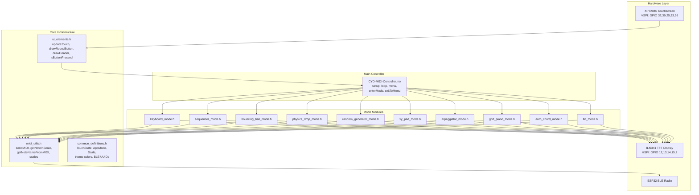

# CYD MIDI Controller — Complete Codebase Knowledge Document

> **Generated**: 2026-02-22  
> **Repository**: `NickCulbertson/CYD-MIDI-Controller`  
> **Language**: C++ (Arduino / ESP32)  
> **Total files**: 17 source files (~95 KB)

---

## Table of Contents

1. [High-Level Overview](#1-high-level-overview)
2. [Tech Stack & Dependencies](#2-tech-stack--dependencies)
3. [Repository Structure & File Index](#3-repository-structure--file-index)
4. [System Architecture](#4-system-architecture)
5. [Core Infrastructure](#5-core-infrastructure)
6. [Feature-by-Feature Analysis](#6-feature-by-feature-analysis)
7. [Cross-Feature Interaction Map](#7-cross-feature-interaction-map)
8. [Nuances, Subtleties & Gotchas](#8-nuances-subtleties--gotchas)
9. [Technical Reference & Glossary](#9-technical-reference--glossary)
10. [How to Add a New Mode](#10-how-to-add-a-new-mode)

---

## 1. High-Level Overview

### What It Is

A **touchscreen Bluetooth MIDI controller** that runs on the **ESP32-2432S028R** ("Cheap Yellow Display" / CYD), a ~$15 ESP32 dev board with a built-in 320×240 ILI9341 TFT display and XPT2046 resistive touchscreen.

### What It Does

The device advertises itself over **BLE (Bluetooth Low Energy)** as a standard MIDI device named `"CYD MIDI"`. When paired with a DAW, synthesizer app, or any BLE MIDI host, the touchscreen provides **10 interactive instrument/controller modes** accessible from a home menu:

| Mode | Menu Label | Purpose |
|------|-----------|---------|
| Keyboard | KEYS | Virtual piano keyboard with scale/key selection |
| Sequencer | BEATS | 16-step × 4-track drum sequencer |
| Bouncing Ball | ZEN | Generative ambient music via physics simulation |
| Physics Drop | DROP | Gravity-based ball drop onto musical platforms |
| Random Generator | RNG | Probability-driven random note generator |
| XY Pad | XY PAD | Two-axis CC controller (filter, modulation, etc.) |
| Arpeggiator | ARP | Chord-based arpeggiator with piano trigger |
| Grid Piano | GRID | Linnstrument-style all-4ths chromatic grid |
| Auto Chord | CHORD | One-touch diatonic chord player |
| LFO | LFO | Low-frequency oscillator for CC/pitchwheel modulation |

### Target Users

Musicians, producers, and hobbyists who want a cheap, wireless, tactile MIDI controller for live performance, studio experimentation, or generative music exploration.

### Business Purpose of Each Feature

- **KEYS / GRID / CHORD** — Direct note/chord input for composition and performance.
- **BEATS** — Rhythm programming without a computer keyboard.
- **ARP** — Automated melodic pattern generation from a single key press.
- **XY PAD / LFO** — Real-time parameter automation (filter sweeps, vibrato, etc.).
- **ZEN / DROP / RNG** — Generative/ambient music creation for inspiration and experimentation.

---

## 2. Tech Stack & Dependencies

### Hardware

| Component | Specification |
|-----------|--------------|
| **MCU** | ESP32 (dual-core Xtensa LX6, 240 MHz) |
| **Board** | ESP32-2432S028R (CYD) |
| **Display** | 320×240 ILI9341 TFT (SPI, HSPI port) |
| **Touch** | XPT2046 resistive touchscreen (VSPI port) |
| **Connectivity** | BLE 4.2 (built into ESP32) |
| **Backlight** | GPIO 21 (active HIGH) |

### Software / Libraries

| Library | Purpose | Key API |
|---------|---------|---------|
| **TFT_eSPI** (Bodmer) | Display driver | `tft.fillScreen()`, `tft.drawCentreString()`, etc. |
| **XPT2046_Touchscreen** (Stoffregen) | Touch input | `ts.touched()`, `ts.getPoint()` |
| **ESP32 BLE Arduino** (built-in) | BLE MIDI transport | `BLEDevice`, `BLEServer`, `BLECharacteristic` |
| **SPI** (built-in) | Hardware SPI bus | `SPIClass(VSPI)` |

### Build Environment

- **IDE**: Arduino IDE
- **Board selection**: "ESP32 Dev Module"
- **Upload speed**: 115200 (recommended if uploads fail)
- **Critical config**: `User_Setup.h` must replace the TFT_eSPI library's default `User_Setup.h`

---

## 3. Repository Structure & File Index

```
CYD-MIDI-Controller/
├── CYD-MIDI-Controller.ino   # Main entry point: setup(), loop(), menu, mode dispatch
├── common_definitions.h       # Shared types, enums, externs, color theme, BLE UUIDs
├── midi_utils.h               # MIDI send, scale definitions, note utilities
├── ui_elements.h              # Touch handling, button drawing, header, navigation
├── keyboard_mode.h            # KEYS mode
├── sequencer_mode.h           # BEATS mode
├── bouncing_ball_mode.h       # ZEN mode
├── physics_drop_mode.h        # DROP mode
├── random_generator_mode.h    # RNG mode
├── xy_pad_mode.h              # XY PAD mode
├── arpeggiator_mode.h         # ARP mode
├── grid_piano_mode.h          # GRID mode
├── auto_chord_mode.h          # CHORD mode
├── lfo_mode.h                 # LFO mode
├── User_Setup.h               # TFT_eSPI hardware pin configuration for CYD
├── README.md                  # User-facing documentation
├── LICENSE                    # MIT License
└── .gitignore                 # .DS_Store exclusion
```

### File Classification

| Priority | File | Type | Lines | Role |
|----------|------|------|-------|------|
| ★★★ | `CYD-MIDI-Controller.ino` | Entry point | 462 | Setup, main loop, menu, mode switching |
| ★★★ | `common_definitions.h` | Shared types | 68 | Enums, structs, externs, theme colors, BLE UUIDs |
| ★★★ | `midi_utils.h` | Core utility | 53 | `sendMIDI()`, scale data, note name lookup |
| ★★★ | `ui_elements.h` | Core utility | 64 | Touch state machine, button/header drawing |
| ★★☆ | `keyboard_mode.h` | Feature | 161 | Piano keyboard |
| ★★☆ | `sequencer_mode.h` | Feature | 218 | Step sequencer |
| ★★☆ | `bouncing_ball_mode.h` | Feature | 376 | Bouncing ball generative music |
| ★★☆ | `physics_drop_mode.h` | Feature | 356 | Gravity ball drop |
| ★★☆ | `random_generator_mode.h` | Feature | 301 | Random note generator |
| ★★☆ | `xy_pad_mode.h` | Feature | 231 | XY CC pad |
| ★★☆ | `arpeggiator_mode.h` | Feature | 403 | Arpeggiator |
| ★★☆ | `grid_piano_mode.h` | Feature | 195 | Grid piano |
| ★★☆ | `auto_chord_mode.h` | Feature | 255 | Auto chord |
| ★★☆ | `lfo_mode.h` | Feature | 321 | LFO modulator |
| ★☆☆ | `User_Setup.h` | Config | 384 | TFT_eSPI pin mapping for CYD hardware |

---

## 4. System Architecture

### Architecture Pattern

**Single-threaded state machine** with a flat module structure. The `.ino` file acts as the orchestrator; each mode is a self-contained header file exposing three functions: `initialize*()`, `draw*()`, and `handle*()`.

### Architecture Diagram



### Data Flow

```
Touch Input → updateTouch() → TouchState struct
                                    ↓
                            loop() switch(currentMode)
                                    ↓
                        handle*Mode() [per-mode logic]
                           ↓                    ↓
                    sendMIDI()              tft.draw*()
                       ↓                        ↓
              BLE notify to DAW         Visual feedback on TFT
```

### Main Loop Cycle

1. `updateTouch()` — reads XPT2046, updates `TouchState` (press/release edge detection)
2. `switch(currentMode)` — dispatches to the active mode's `handle*()` function
3. Each mode handles its own touch interaction, animation updates, and MIDI output
4. `delay(20)` — ~50 Hz base loop rate (individual modes may have their own timing)

### SPI Bus Architecture

The CYD uses **two separate SPI buses**:
- **HSPI** (`USE_HSPI_PORT` in `User_Setup.h`) — TFT display (GPIO 12/13/14/15/2)
- **VSPI** (explicit `SPIClass(VSPI)`) — XPT2046 touchscreen (GPIO 32/39/25/33)

This avoids bus contention between display writes and touch reads.

---

## 5. Core Infrastructure

### 5.1 BLE MIDI (`CYD-MIDI-Controller.ino` + `common_definitions.h`)

**Standard BLE MIDI specification** using the official MIDI over BLE UUIDs:
- Service: `03b80e5a-ede8-4b33-a751-6ce34ec4c700`
- Characteristic: `7772e5db-3868-4112-a1a9-f2669d106bf3`

**Packet format** (`midi_utils.h:18-26`):
```cpp
uint8_t midiPacket[] = {0x80, 0x80, 0x00, 0x60, 0x7F};
//                       ^     ^     ^     ^     ^
//                       |     |     |     |     velocity/value
//                       |     |     |     note/CC number
//                       |     |     MIDI status byte
//                       |     timestamp low
//                       timestamp high + header
```

The first two bytes are BLE MIDI timestamp headers (fixed at `0x80, 0x80`). Bytes 2-4 are the standard 3-byte MIDI message.

**Connection callbacks** (`CYD-MIDI-Controller.ino:86-105`):
- On connect: redraws menu (clears "BLE WAITING..." message)
- On disconnect: redraws menu, sends Note Off for all 128 MIDI notes (panic)

**Key function**: `sendMIDI(byte cmd, byte note, byte vel)` in `midi_utils.h:18-26`
- Guards on `deviceConnected` — silently drops messages when no BLE host connected
- Used by every mode for all MIDI output

### 5.2 Touch System (`ui_elements.h:15-26`)

The `TouchState` struct provides edge-detection:

| Field | Type | Meaning |
|-------|------|---------|
| `isPressed` | `bool` | Currently touching screen |
| `wasPressed` | `bool` | Was touching last frame |
| `justPressed` | `bool` | Rising edge (new press) |
| `justReleased` | `bool` | Falling edge (lifted finger) |
| `x`, `y` | `int` | Screen coordinates (0-320, 0-240) |

**Coordinate mapping** (`ui_elements.h:23-24`):
```cpp
touch.x = map(p.x, 200, 3700, 0, 320);
touch.y = map(p.y, 240, 3800, 0, 240);
```
Raw ADC values are mapped to screen pixels. These magic numbers are calibration values for the CYD's specific touchscreen.

**Hit testing**: `isButtonPressed(x, y, w, h)` — simple rectangle bounds check against current `touch.x`/`touch.y`.

### 5.3 UI Drawing (`ui_elements.h:32-58`)

- **`drawRoundButton()`** — Rounded rectangle button with border, optional pressed state (inverts colors)
- **`drawHeader()`** — Standard 45px header bar with title, subtitle, and "BACK" button at (10, 10, 50, 25)
- **`updateStatus()`** — Currently a no-op (status bar removed by design decision)

### 5.4 Music Theory (`midi_utils.h:7-37`)

**Six scales** defined globally:

| Index | Name | Intervals | Notes |
|-------|------|-----------|-------|
| 0 | Major | 0,2,4,5,7,9,11 | 7 |
| 1 | Minor | 0,2,3,5,7,8,10 | 7 |
| 2 | Dorian | 0,2,3,5,7,9,10 | 7 |
| 3 | Pentatonic | 0,2,4,7,9 | 5 |
| 4 | Blues | 0,3,5,6,7,10 | 6 |
| 5 | Chromatic | 0,1,2,3,4,5,6,7 | 8 |

**`getNoteInScale(scaleIndex, degree, octave)`** — Returns a MIDI note number. Root is always C (MIDI 60 = C4). Wraps degrees that exceed the scale's note count into the next octave.

**`getNoteNameFromMIDI(midiNote)`** — Returns display string like `"C#4"`.

**`stopAllModes()`** — Sends Note Off (0x80) for all 128 MIDI notes. Used when exiting any mode.

### 5.5 Color Theme (`common_definitions.h:8-19`)

All colors are 16-bit RGB565 format:

| Constant | Hex | Approximate Color |
|----------|-----|-------------------|
| `THEME_BG` | `0x0841` | Very dark gray |
| `THEME_SURFACE` | `0x2945` | Dark gray |
| `THEME_PRIMARY` | `0x06FF` | Cyan-blue |
| `THEME_SECONDARY` | `0xFD20` | Orange |
| `THEME_ACCENT` | `0x07FF` | Cyan |
| `THEME_SUCCESS` | `0x07E0` | Green |
| `THEME_WARNING` | `0xFFE0` | Yellow |
| `THEME_ERROR` | `0xF800` | Red |
| `THEME_TEXT` | `0xFFFF` | White |
| `THEME_TEXT_DIM` | `0x8410` | Medium gray |

### 5.6 Menu System (`CYD-MIDI-Controller.ino:63-82, 214-271`)

The `AppIcon` struct and `apps[]` array form a **scalable icon registry**. The menu renders a 5-column grid of 40×40 rounded-rectangle icons with custom mini-graphics drawn by `drawAppGraphics()`.

**Menu layout**: 5 columns × 2 rows, centered horizontally, starting at Y=65.

**Touch dispatch** (`handleMenuTouch()`): Iterates `apps[]`, checks bounds for each icon, calls `enterMode(apps[i].mode)`.

**Mode entry** (`enterMode()`): Sets `currentMode`, calls the mode's `draw*()` function, calls `updateStatus()`.

**Mode exit** (`exitToMenu()`): Sets `currentMode = MENU`, calls `stopAllModes()` (MIDI panic), redraws menu.

---

## 6. Feature-by-Feature Analysis

---

### 6.1 KEYS — Virtual Piano Keyboard (`keyboard_mode.h`)

**Purpose**: Play notes on a scale-quantized piano keyboard. Supports sliding between keys.

**Layout**: 2 rows × 10 keys. Row 0 = base octave, Row 1 = one octave higher. Key width = 32px, key height = 55px.

**Controls** (Y=180):
| Button | Position | Action |
|--------|----------|--------|
| OCT- | (10, 180) | Decrease octave (min 1) |
| OCT+ | (60, 180) | Increase octave (max 8) |
| SCALE | (110, 180) | Cycle through 6 scales |
| KEY- | (170, 180) | Transpose down 1 semitone |
| KEY+ | (220, 180) | Transpose up 1 semitone |

**MIDI output**: Note On `0x90` with velocity 100, Note Off `0x80` with velocity 0.

**Key sliding**: When the finger moves to a different key (tracked by `lastKey`/`lastRow`), the previous note is turned off and the new note turned on — enabling glissando-style playing.

**Note calculation**: `getNoteInScale(keyboardScale, keyIndex, keyboardOctave + row) + keyboardKey`
- `keyboardKey` (0-11) transposes by semitones (key signature)

**State variables**: `keyboardOctave`, `keyboardScale`, `keyboardKey`, `lastKey`, `lastRow`

---

### 6.2 BEATS — 16-Step Drum Sequencer (`sequencer_mode.h`)

**Purpose**: Program 808-style drum patterns with 4 tracks and tempo control.

**Grid**: 4 tracks × 16 steps. Each step cell is 15×28px. Every 4th step has a highlighted border (measure markers).

**Tracks** (hardcoded drum mapping on MIDI channel 1):

| Track | Label | MIDI Note | Note Length |
|-------|-------|-----------|-------------|
| 0 | KICK | 36 (C2) | 200ms |
| 1 | SNRE | 38 (D2) | 150ms |
| 2 | HHAT | 42 (F#2) | 50ms |
| 3 | OPEN | 46 (A#2) | 300ms |

**Controls** (Y=200):
| Button | Action |
|--------|--------|
| PLAY/STOP | Toggle playback |
| CLEAR | Reset all patterns |
| BPM- | Decrease BPM (min 60, step 1) |
| BPM+ | Increase BPM (max 200, step 1) |

**Timing**: `stepInterval = 60000 / bpm / 4` (16th note resolution). Each step, active track notes fire Note On with velocity 100. Note Off is scheduled via `noteOffTime[]` array and checked every loop iteration.

**State**: `sequencePattern[4][16]` (bool grid), `currentStep`, `bpm`, `sequencerPlaying`

---

### 6.3 ZEN — Bouncing Ball Ambient Mode (`bouncing_ball_mode.h`)

**Purpose**: Generative ambient music. Balls bounce inside a rectangular arena; wall collisions trigger notes.

**Arena**: Rectangular play area from (53, 63) to (272, 177).

**Walls**: 24 segments total:
- 8 top segments, 8 bottom segments (horizontal, each 28px wide)
- 4 left segments, 4 right segments (vertical, each 28px tall)
- Each wall segment has a unique MIDI note assigned from the current scale

**Balls**: Up to 4 (`MAX_BALLS`). Each has position, velocity, color, size. Initial velocity range: -1.5 to 1.5 (slow, zen-like).

**Collision detection** (`checkWallCollisions()`): Direction-aware — checks ball movement direction against wall side to prevent double-triggers. Uses `lastX[]`/`lastY[]` static arrays. Only one wall triggers per ball per frame.

**MIDI output**: On wall collision, sends Note On with random velocity (70-110), immediately followed by Note Off (percussive hit).

**Controls**: ADD (more balls), RESET, SCALE, KEY-/KEY+, OCT

**Animation**: ~60 FPS (16ms frame time). Clears entire play area each frame then redraws walls and balls.

---

### 6.4 DROP — Physics Ball Drop (`physics_drop_mode.h`)

**Purpose**: Drop balls from touch position; they fall under gravity and bounce off user-placed platforms, triggering notes.

**Physics model** per `DropBall`:
- Gravity: 0.15 units/frame
- Bounce coefficient: 0.6 (energy loss per bounce)
- Friction: 0.98 (horizontal damping)
- Ball lifetime: 5 seconds (`spawnTime` checked)

**Platforms**: Up to 6 (`MAX_PLATFORMS`). Each has position, width (50px default), angle (-0.5 to 0.5 radians), assigned note. 3 default platforms created on init.

**Two sub-modes** (toggled by EDIT/DROP button):
- **Drop mode**: Tap play area → spawn ball at touch location
- **Platform edit mode**: Tap play area → add platform at touch location

**Platform collision**: Simple AABB, only triggers when ball is falling (`vy > 0`). Platform angle affects horizontal bounce direction (`vx += angle * 1.5`). Ground hits also trigger the ball's assigned note.

**Animation**: ~20 FPS (50ms frame time, reduced from 60 FPS to minimize flickering). Uses erase-previous-position technique instead of full-area clear.

**MIDI output**: Note On + immediate Note Off on platform/ground collision. Random velocity 60-110.

---

### 6.5 RNG — Random Music Generator (`random_generator_mode.h`)

**Purpose**: Probability-driven random note generation synced to BPM. Good for creating unexpected melodic ideas.

**Parameters** (all adjustable via UI):

| Parameter | Default | Range | Step |
|-----------|---------|-------|------|
| Root note | C4 (60) | 0-127 | 1 |
| Scale | Major | 6 scales | cycle |
| Min octave | 3 | 1-8 | 1 |
| Max octave | 6 | minOct+1 to 9 | 1 |
| Probability | 50% | 0-100% | 5% |
| BPM | 120 | 60-200 | 5 |
| Subdivision | 1/4 | 1/4, 1/8, 1/16 | cycle |

**Note interval calculation** (`calculateNoteInterval()`):
```
notesPerSecond = (bpm / 60.0) * (subdivision / 4.0)
noteInterval = 1000.0 / notesPerSecond
```

**Note generation**: At each interval, roll `random(100) < probability`. If true, pick random scale degree and random octave within range, compute MIDI note, send Note On. Previous note is always turned off first (monophonic).

**Visual feedback**: Displays "Now: [note name]" when a note is playing. Probability shown as a progress bar.

---

### 6.6 XY PAD — Touch CC Controller (`xy_pad_mode.h`)

**Purpose**: Real-time two-axis MIDI CC control via touch position on a pad. Typical use: filter cutoff (X) and resonance (Y).

**Pad area**: 200×140px at position (20, 60). Has crosshairs at center and a position indicator dot.

**Default CC mapping**:
- X axis: CC 74 (Cutoff/Filter Frequency)
- Y axis: CC 71 (Resonance/Filter Q)

**Value mapping**:
- X: Left edge = 0, right edge = 127
- Y: Bottom = 0, top = 127 (inverted from screen Y)

**MIDI output**: Sends `0xB0` (CC on channel 1) for both axes on every touch update while pad is pressed.

**CC assignment controls**: Located to the right of the pad. Each axis has +/- buttons to change CC number (0-127).

**Display optimization**: Uses static variables to track previous indicator position and only redraws changed elements. Crosshairs and border are repaired after erasing the old indicator. A `xyPadNeedsReset` flag resets static state when the mode is re-entered.

---

### 6.7 ARP — Arpeggiator (`arpeggiator_mode.h`)

**Purpose**: Automatically arpeggiate chords triggered from a piano keyboard. Supports multiple patterns, chord types, speeds, and octave ranges.

**Piano keyboard**: 12 chromatic keys at the bottom of the screen (Y=160, 45px tall). Pressing a key triggers an arpeggio rooted on that note. Pressing the same key again stops it. Pressing a different key switches the arp root without resetting timing.

**Chord types**: Major (0,4,7), Minor (0,3,7), Dominant 7th (0,4,7,10)

**Patterns** (5 total):
| Index | Name | Behavior |
|-------|------|----------|
| 0 | UP | Ascending through chord tones across octaves |
| 1 | DOWN | Descending |
| 2 | UP/DN | Ascending then descending (ping-pong) |
| 3 | RAND | Random chord tone selection |
| 4 | CHANCE | Like UP but 30% chance to skip any note |

**Speed options**: 4th, 8th, 16th, 32nd notes. Interval = `1000.0 / ((bpm/60.0) * (speed/4.0))`.

**Octave range**: 1-4 octaves. Total steps = `chordLength × octaves`.

**MIDI output**: Monophonic — turns off previous note before playing next. Velocity fixed at 100.

**State**: `Arpeggiator` struct contains all parameters. `triggeredKey` tracks which piano key started the arp.

---

### 6.8 GRID — Grid Piano (`grid_piano_mode.h`)

**Purpose**: Linnstrument-inspired chromatic note grid with all-4ths tuning. Each row is a perfect 4th (5 semitones) higher than the row below.

**Grid**: 5 rows × 8 columns. Cell size: 35×25px. Layout starts at (10, 55).

**Note layout** (`calculateGridLayout()`):
```
baseNote = 36 + (gridOctave - 3) * 12  // C3 default
note[row][col] = baseNote + col + ((GRID_ROWS - 1 - row) * 5)
```
Row 0 = top of screen = highest notes. Row 4 = bottom = lowest notes.

**Visual differentiation**: Black keys (sharps/flats) get `THEME_SURFACE` background with dim text; natural notes get `THEME_BG` background with white text. Pressed note highlighted in `THEME_PRIMARY`.

**MIDI output**: Monophonic — only one grid cell active at a time. Supports sliding between cells (like keyboard mode). Velocity fixed at 100.

**Controls**: OCT- (min 1), OCT+ (max 6). Current note name displayed.

---

### 6.9 CHORD — Auto Chord Mode (`auto_chord_mode.h`)

**Purpose**: One-touch diatonic chord playing. Presents 8 chord buttons (I through I+) based on the selected scale.

**Chord definitions** (`diatonicChords[]`):

| Degree | Roman | Type | Intervals |
|--------|-------|------|-----------|
| 0 | I | Major | 0, 4, 7 |
| 1 | ii | Minor | 0, 3, 7 |
| 2 | iii | Minor | 0, 3, 7 |
| 3 | IV | Major | 0, 4, 7 |
| 4 | V | Major | 0, 4, 7 |
| 5 | vi | Minor | 0, 3, 7 |
| 6 | vii° | Diminished | 0, 3, 6 |
| 7 | I+ | Major (octave up) | 0, 4, 7 |

**Layout**: 8 equally-spaced keys (40px wide × 80px tall, Y=80). Each colored by degree. Shows Roman numeral and root note name.

**Behavior**: **Monophonic chord hold** — only one chord sounds at a time. When touching a chord key, all other active chords are turned off. When touch is released, all chords stop. This enables strumming/progression playing.

**MIDI output**: Polyphonic within a single chord — sends simultaneous Note On for root, 3rd, and 5th (velocity 100). Note range guard: 24-108. Tracks active notes per chord degree in `activeChordNotes[8][4]`.

**Controls**: OCT-/OCT+, SCALE (cycles 6 scales), CLEAR (stops all chords).

---

### 6.10 LFO — Low Frequency Oscillator (`lfo_mode.h`)

**Purpose**: Automated periodic modulation of a MIDI CC parameter or pitch wheel. Creates effects like vibrato, tremolo, filter sweeps, wobble bass.

**Parameters**:

| Parameter | Default | Range | Step |
|-----------|---------|-------|------|
| Rate | 1.0 Hz | 0.1-10.0 Hz | 0.1 |
| Amount | 64 | 0-127 | 5 |
| Waveform | Sine | Sine, Tri, Square, Saw | cycle |
| CC Target | 1 (Mod wheel) | 0-127 | 1 |
| Pitch mode | Off | On/Off | toggle |

**Waveform calculation** (`calculateLFOValue()`):
- **Sine**: `sin(phase)`
- **Triangle**: Linear interpolation, -1 to 1 to -1
- **Square**: +1 or -1 based on phase vs π
- **Sawtooth**: Linear ramp -1 to +1

**Output calculation**:
- **CC mode**: `64 + (lfoValue * amount / 2)`, clamped 0-127, sent as `0xB0`
- **Pitch wheel mode**: `8192 + (lfoValue * amount * 64)`, clamped 0-16383, sent as `0xE0` with 7-bit LSB/MSB split

**MIDI spam reduction**: Only sends when `abs(outputValue - lastValue) >= 1`. Display updates every 10th value change.

**Phase tracking**: Uses real-time delta: `phase += 2π × rate × deltaTime`. This makes the LFO frequency-accurate regardless of loop timing.

**Visual**: Mini waveform preview (200×30px) rendered pixel-by-pixel at bottom of screen.

**Special**: `sendLFOValue()` directly manipulates `midiPacket[]` for pitch bend (bypasses `sendMIDI()` which only handles 3-byte messages).

---

## 7. Cross-Feature Interaction Map

### Shared Dependencies

All 10 modes share these globals via `extern` declarations in `common_definitions.h`:

```
tft (TFT_eSPI) ← display output
ts (XPT2046_Touchscreen) ← touch input (via updateTouch)
touch (TouchState) ← processed touch state
pCharacteristic (BLECharacteristic*) ← BLE MIDI output
deviceConnected (bool) ← BLE connection status
midiPacket[] (uint8_t[5]) ← shared MIDI packet buffer
currentMode (AppMode) ← state machine variable
scales[] (Scale[]) ← shared scale definitions
```

### Feature Interaction Patterns

```
┌──────────────────────────────────────────────────────────┐
│                    MENU (dispatcher)                      │
│  enterMode() → sets currentMode, calls draw*()           │
│  exitToMenu() → stopAllModes(), redraws menu             │
└──────────────────────────────────────────────────────────┘
         │
         ▼
┌─────────────────────────────────────┐
│         Mode Categories             │
│                                     │
│  NOTE PLAYERS:  KEYS, GRID, CHORD   │──── All use scales[], getNoteInScale()
│  SEQUENCER:     BEATS               │──── Uses fixed drum note mapping
│  GENERATIVE:    ZEN, DROP, RNG      │──── All use scales[], physics/random
│  CONTROLLERS:   XY PAD, LFO        │──── Send CC/Pitchwheel, not notes
│  HYBRID:        ARP                 │──── Piano input + auto note generation
└─────────────────────────────────────┘
```

### Modes Do NOT Interact With Each Other

Each mode is entirely self-contained. There is no inter-mode communication, no shared state between modes (beyond the global infrastructure), and no way to run two modes simultaneously. When switching modes, `stopAllModes()` sends a full MIDI panic (all 128 Note Offs).

### Scale System Users

Modes that use the shared `scales[]` and `getNoteInScale()`:
- **KEYS** — note-per-key quantized to scale
- **ZEN** — wall notes assigned from scale
- **DROP** — ball/platform notes from scale
- **RNG** — random note selection within scale
- **ARP** — (uses chord intervals, not scale directly, but scale name displayed)
- **CHORD** — chord root notes derived from scale degrees

Modes that do NOT use scales:
- **BEATS** — fixed drum note mapping
- **GRID** — chromatic (all semitones)
- **XY PAD** — CC only, no notes
- **LFO** — CC/pitchwheel only, no notes

---

## 8. Nuances, Subtleties & Gotchas

### Things You Must Know Before Changing Code

#### 1. Header-Only Architecture (No `.cpp` Files)

Every module is a `.h` file containing **both declarations and implementations**. This is an Arduino-specific pattern — the `.ino` file `#include`s all headers, and the Arduino build system compiles everything as a single translation unit. This means:

- **No ODR violations occur** because there's only one compilation unit
- **All global variables in headers are true globals**, not duplicated per-TU
- If you add a `.cpp` file, you will get linker errors for multiply-defined symbols
- **You cannot `#include` a mode header from another mode header** — this would create circular dependencies and duplicate symbol definitions

#### 2. Shared `midiPacket[]` Buffer

All MIDI output shares a single 5-byte buffer (`CYD-MIDI-Controller.ino:43`). The LFO mode's `sendLFOValue()` directly modifies bytes 2-4 of this buffer for pitch bend messages. This is safe only because the system is single-threaded, but be aware that any future use of FreeRTOS tasks for MIDI output would create a race condition.

#### 3. Touch Calibration Magic Numbers

`ui_elements.h:23-24`: The values `200, 3700, 240, 3800` are ADC-to-pixel calibration constants specific to the CYD's touchscreen. Different CYD units may need slightly different values. There is no runtime calibration.

#### 4. The 20ms Main Loop Delay

`CYD-MIDI-Controller.ino:211`: `delay(20)` caps the main loop at ~50 Hz. However, individual modes add their own timing:
- ZEN: 16ms (60 FPS target)
- DROP: 50ms (20 FPS target)
- These use `millis()` delta checks, so they're not affected by the main loop delay

The main loop delay means touch response has ~20ms latency minimum.

#### 5. Static Variables Inside Functions

Several modes use `static` variables inside functions (e.g., `updateBouncingBall()`, `updatePhysics()`, `drawXYPad()`). These persist across calls but are **never reset when re-entering a mode** unless explicitly handled. The XY Pad mode addresses this with a `xyPadNeedsReset` flag — other modes (ZEN, DROP) do not have equivalent reset mechanisms, which could cause stale state on mode re-entry.

#### 6. BLE Disconnect MIDI Panic Is Expensive

`MIDICallbacks::onDisconnect()` sends 128 Note Off messages sequentially. On reconnect, this delay is noticeable. The same pattern occurs in `stopAllModes()`.

#### 7. All Modes Initialize at Boot

`setup()` calls `initialize*()` for every mode at startup, even though only the menu is displayed. This means all global state for all modes is allocated at boot. This is intentional — it avoids allocation during mode switches — but it means ~3 KB of RAM is always committed to mode state.

#### 8. Display Rotation

Both touch and display are set to rotation 1 (landscape, 320×240). Changing this requires updating both `tft.setRotation(1)` and `ts.setRotation(1)`, plus all hardcoded coordinate values throughout the entire codebase.

#### 9. Backlight Control

GPIO 21 is set HIGH in `setup()` (`CYD-MIDI-Controller.ino:118-119`). This turns on the backlight. There's no brightness control or sleep mode implemented.

#### 10. No MIDI Channel Selection

All MIDI messages go out on **channel 1** (status byte `0x90` = Note On ch1, `0x80` = Note Off ch1, `0xB0` = CC ch1, `0xE0` = Pitchbend ch1). There is no UI to change the MIDI channel.

#### 11. Sequencer Note-Off Scheduling

The sequencer uses a `noteOffTime[]` array with `millis()` comparison — not interrupt-based. If the main loop stalls, note-offs could be delayed. This is rarely noticeable in practice but is technically imprecise.

#### 12. Immediate Note On/Off in Generative Modes

ZEN and DROP send Note On immediately followed by Note Off (percussive). This relies on the BLE stack processing both packets before the receiver expects a sustained note. Some MIDI hosts may not register notes this short. A small delay or proper note duration would be more robust.

#### 13. Version Number

Hardcoded as `"v0.1"` in `drawMenu()` at line 227. Not derived from any build variable.

#### 14. `MAX_APPS` vs `numApps`

`MAX_APPS` is defined as 12 (for a potential 3×4 grid), but `numApps` is set to 10. Adding apps beyond `numApps` in the `apps[]` array won't crash but won't display. The layout always uses 5 columns.

---

## 9. Technical Reference & Glossary

### Glossary

| Term | Definition |
|------|-----------|
| **CYD** | "Cheap Yellow Display" — ESP32-2432S028R dev board with integrated TFT + touch |
| **BLE MIDI** | Bluetooth Low Energy MIDI specification for wireless MIDI transport |
| **CC** | MIDI Control Change — messages for continuous parameters (0-127) |
| **Pitch Bend** | 14-bit MIDI message (0-16383, center 8192) for pitch modulation |
| **Scale degree** | Position within a musical scale (0 = root, 1 = 2nd, etc.) |
| **Semitone** | Smallest interval in Western music; +1 MIDI note number |
| **Octave** | 12 semitones; MIDI octave 4 starts at note 60 (C4) |
| **Step sequencer** | Grid-based pattern where each column is a time step |
| **Arpeggiator** | Plays chord notes one at a time in a pattern |
| **LFO** | Low Frequency Oscillator — periodic modulation source |
| **RGB565** | 16-bit color format: 5 bits red, 6 bits green, 5 bits blue |
| **VSPI / HSPI** | ESP32's two hardware SPI peripherals |
| **Note On / Off** | MIDI messages `0x90` (on) and `0x80` (off) + note + velocity |

### Key Functions Reference

| Function | File | Purpose |
|----------|------|---------|
| `setup()` | `CYD-MIDI-Controller.ino:107` | Hardware init, BLE init, mode init, draw menu |
| `loop()` | `CYD-MIDI-Controller.ino:172` | Main loop: touch update → mode dispatch → delay |
| `drawMenu()` | `CYD-MIDI-Controller.ino:214` | Render home screen with app icons |
| `handleMenuTouch()` | `CYD-MIDI-Controller.ino:400` | Check icon bounds, dispatch to mode |
| `enterMode(AppMode)` | `CYD-MIDI-Controller.ino:420` | Set mode, call draw function |
| `exitToMenu()` | `CYD-MIDI-Controller.ino:457` | MIDI panic, return to menu |
| `sendMIDI(cmd, note, vel)` | `midi_utils.h:18` | Send 3-byte MIDI via BLE |
| `getNoteInScale(scale, degree, octave)` | `midi_utils.h:28` | Scale-quantized note lookup |
| `getNoteNameFromMIDI(note)` | `midi_utils.h:39` | MIDI note → display name |
| `stopAllModes()` | `midi_utils.h:46` | Send all-notes-off |
| `updateTouch()` | `ui_elements.h:15` | Read touch, compute edges |
| `isButtonPressed(x,y,w,h)` | `ui_elements.h:28` | Rectangle hit test |
| `drawRoundButton(...)` | `ui_elements.h:32` | Styled button rendering |
| `drawHeader(title, subtitle)` | `ui_elements.h:45` | Mode header with BACK button |

### MIDI Message Types Used

| Status | Hex | Type | Parameters |
|--------|-----|------|-----------|
| Note Off | `0x80` | Note release | note (0-127), velocity (0) |
| Note On | `0x90` | Note press | note (0-127), velocity (1-127) |
| Control Change | `0xB0` | CC | CC# (0-127), value (0-127) |
| Pitch Bend | `0xE0` | Pitch wheel | LSB (0-127), MSB (0-127) |

### Pin Map (CYD ESP32-2432S028R)

| GPIO | Function | Bus |
|------|----------|-----|
| 12 | TFT MISO | HSPI |
| 13 | TFT MOSI | HSPI |
| 14 | TFT SCLK | HSPI |
| 15 | TFT CS | HSPI |
| 2 | TFT DC | HSPI |
| 21 | TFT Backlight | GPIO |
| 32 | Touch MOSI | VSPI |
| 39 | Touch MISO | VSPI |
| 25 | Touch CLK | VSPI |
| 33 | Touch CS | VSPI |
| 36 | Touch IRQ | VSPI |

### Per-Mode State Summary

| Mode | Key Structs/Arrays | Animation FPS | MIDI Type |
|------|-------------------|---------------|-----------|
| KEYS | `keyboardOctave/Scale/Key`, `lastKey/lastRow` | N/A | Note On/Off |
| BEATS | `sequencePattern[4][16]`, `noteOffTime[4]` | N/A (step-driven) | Note On/Off (drums) |
| ZEN | `Ball balls[4]`, `Wall walls[24]` | 60 | Note On+Off (percussive) |
| DROP | `DropBall[8]`, `Platform[6]` | 20 | Note On+Off (percussive) |
| RNG | `RandomGen` struct | N/A (timer-driven) | Note On/Off (monophonic) |
| XY PAD | `xCC`, `yCC`, `xValue`, `yValue` | N/A (continuous) | CC |
| ARP | `Arpeggiator` struct, piano keys | N/A (step-driven) | Note On/Off (monophonic) |
| GRID | `gridLayout[5][8]` | N/A | Note On/Off (monophonic) |
| CHORD | `diatonicChords[8]`, `activeChordNotes[8][4]` | N/A | Note On/Off (polyphonic) |
| LFO | `LFOParams` struct | N/A (continuous) | CC or Pitchbend |

---

## 10. How to Add a New Mode

The codebase is explicitly designed for mode extensibility. The comment at `CYD-MIDI-Controller.ino:54-62` outlines the process:

### Step-by-Step

1. **Add enum value** to `AppMode` in `common_definitions.h:34-46`
2. **Create header file** `new_mode.h` with:
   - `#include "common_definitions.h"`, `"ui_elements.h"`, `"midi_utils.h"`
   - `initializeNewMode()` — set default state
   - `drawNewMode()` — full screen redraw (call `drawHeader()`)
   - `handleNewMode()` — touch handling + logic updates
3. **Include header** in `CYD-MIDI-Controller.ino`
4. **Add to `setup()`** — call `initializeNewMode()`
5. **Add to `loop()` switch** — `case NEW_MODE: handleNewMode(); break;`
6. **Add to `enterMode()` switch** — `case NEW_MODE: drawNewMode(); break;`
7. **Add entry to `apps[]` array** with name, symbol, color, and `AppMode`
8. **Add icon graphics** case to `drawAppGraphics()`
9. **Increment `numApps`** (or ensure it reflects `sizeof(apps)/sizeof(apps[0])`)

### Conventions to Follow

- Every mode handles its own BACK button: `if (touch.justPressed && isButtonPressed(10, 10, 50, 25)) { exitToMenu(); return; }`
- Controls go at Y ≥ 180 to avoid header/content overlap
- Use `drawRoundButton()` for consistent button styling
- Guard all MIDI sends with `if (!deviceConnected) return;`
- Use `THEME_*` constants for all colors
- Status/info text uses `THEME_TEXT_DIM`

---

## Appendix A: Build & Upload Checklist

1. Install Arduino IDE with ESP32 board support (URL: `https://espressif.github.io/arduino-esp32/package_esp32_index.json`)
2. Install libraries: `TFT_eSPI`, `XPT2046_Touchscreen`
3. Replace `libraries/TFT_eSPI/User_Setup.h` with repo's `User_Setup.h`
4. Board: "ESP32 Dev Module"
5. Upload speed: 115200 if default fails
6. BLE name: "CYD MIDI" — discoverable after boot

## Appendix B: Memory Budget Estimate

| Component | Approximate RAM |
|-----------|----------------|
| TFT_eSPI display buffer | ~1 KB |
| BLE stack | ~30 KB |
| Mode state (all modes) | ~3 KB |
| Touch state | ~20 bytes |
| MIDI packet buffer | 5 bytes |
| Stack | ~8 KB |
| **Total estimate** | ~42 KB of ~320 KB available |

The ESP32 has 520 KB SRAM, with ~320 KB usable after BLE stack allocation. Memory is not a concern for this application.
